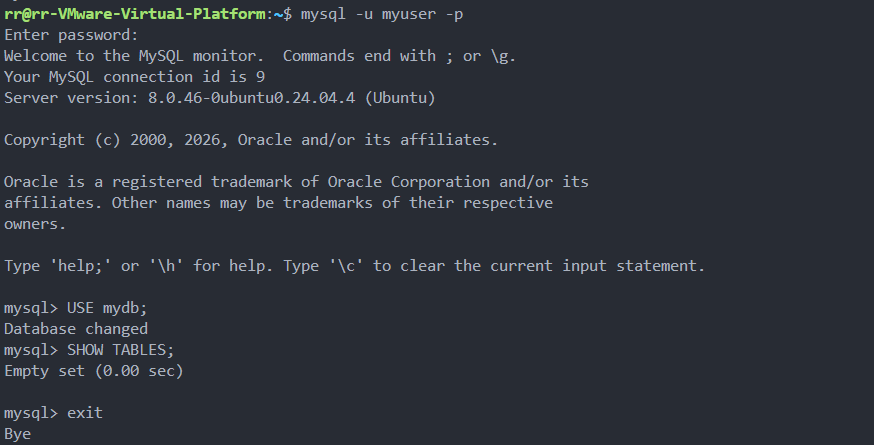
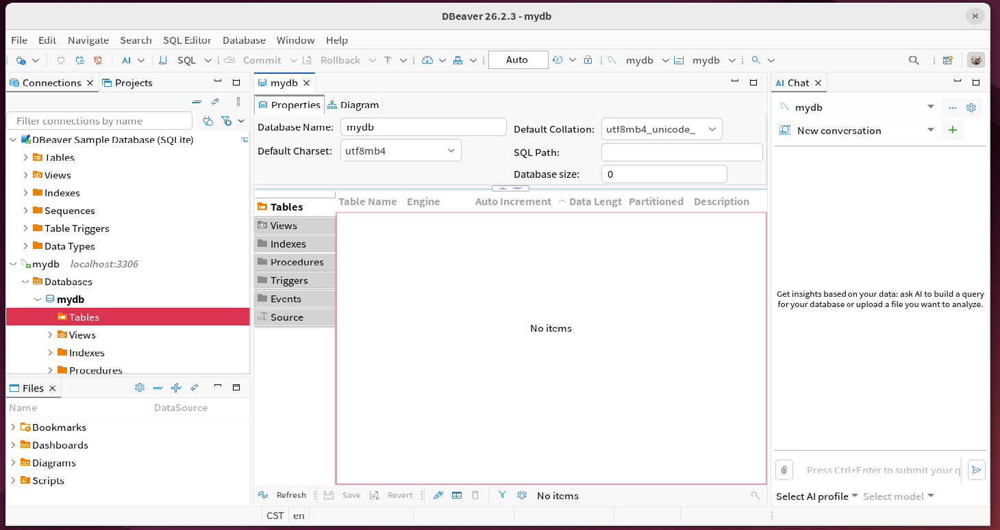

# 搭建 MySQL 服务器

学号：B24040220；姓名：陈方润。

## 一、创建数据库和用户

在 Ubuntu 终端进入 MySQL 管理界面并执行：

```sql
CREATE DATABASE mydb CHARACTER SET utf8mb4 COLLATE utf8mb4_unicode_ci;
CREATE USER 'myuser'@'localhost' IDENTIFIED BY '111111';
GRANT ALL PRIVILEGES ON mydb.* TO 'myuser'@'localhost';
FLUSH PRIVILEGES;
SHOW DATABASES;
```

结果：成功创建数据库 `mydb` 和本机用户 `myuser`，并将 `mydb` 的权限授予该用户。


## 二、验证用户访问

使用 `myuser` 登录后执行：

```sql
USE mydb;
SHOW TABLES;
```

结果：成功切换到 `mydb`。当前数据库没有数据表，因此 `SHOW TABLES` 返回空集。



## 三、DBeaver 连接

通过 DBeaver 使用 `localhost:3306` 和用户 `myuser` 连接 MySQL，并打开 `mydb`。连接成功，数据库当前为空。


