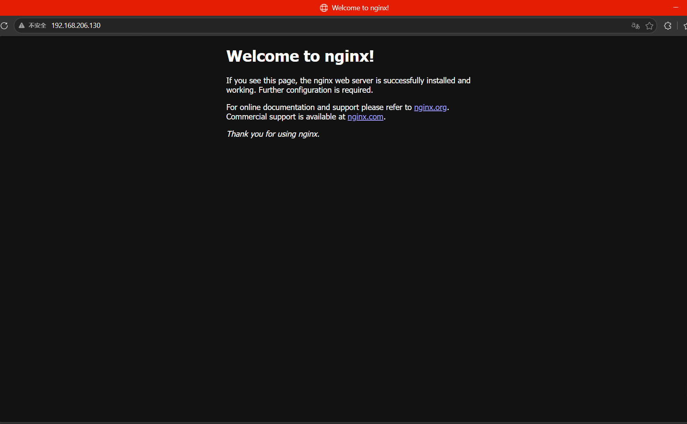
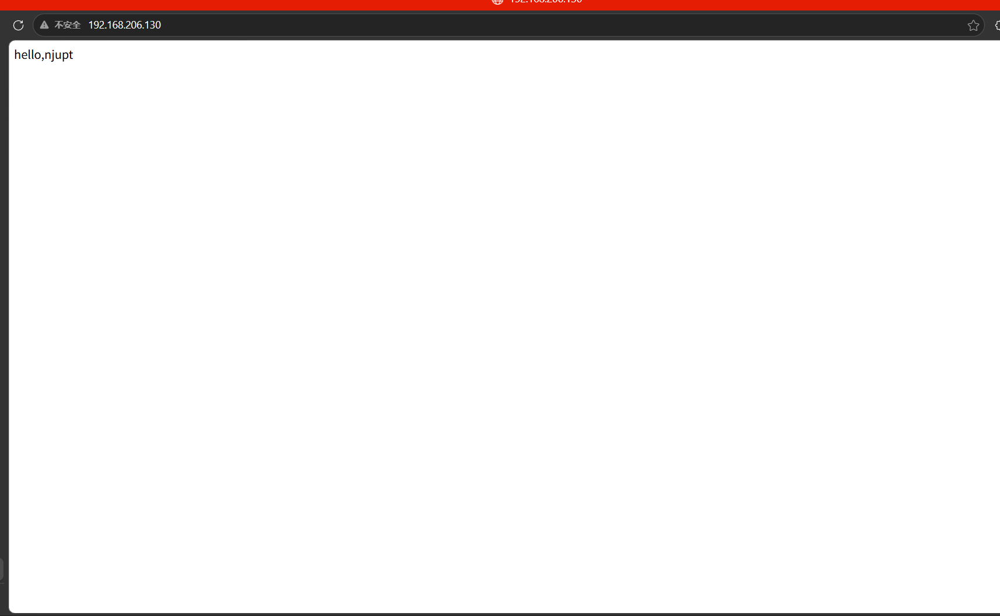

# 搭建 nginx Web 服务器

学号：B24040220；姓名：陈方润。

## 一、默认页面访问

浏览器访问 `http://192.168.206.130`，显示 `Welcome to nginx!` 默认欢迎页，说明该地址的 Web 服务可以访问。

## 二、修改页面验证

修改网页内容后，再次访问同一地址，页面显示 `hello,njupt`，验证修改后的页面可正常访问。

## 三、实验结果

完成 nginx 页面访问和网页内容修改验证，两张截图记录了修改前后的结果。
