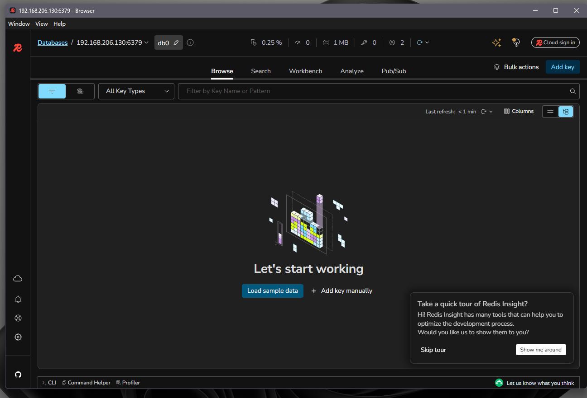
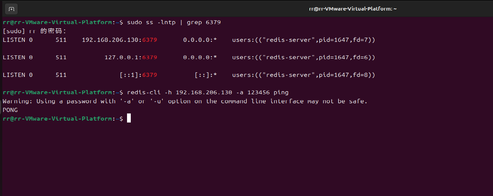

# 搭建 Redis 服务器

学号：B24040220；姓名：陈方润。

## 一、安装和启动

在 Ubuntu 虚拟机安装 Redis Server，并检查服务与本机连接：

```bash
sudo apt install redis-server
systemctl is-active redis-server
redis-cli ping
```

结果：Redis 服务状态为 `active`，本机测试返回 `PONG`。

## 二、配置远程连接

虚拟机地址为 `192.168.206.130`。修改 `/etc/redis/redis.conf`，将监听地址设为虚拟机回环地址及局域网地址，并按作业示例设置密码：

```conf
bind 127.0.0.1 192.168.206.130 -::1
requirepass 123456
```

重启服务并验证密码：

```bash
sudo systemctl restart redis-server
systemctl is-active redis-server
redis-cli -a 123456 ping
```

结果：服务为 `active`，密码认证后返回 `PONG`。Windows 使用 `Test-NetConnection 192.168.206.130 -Port 6379` 测试，`TcpTestSucceeded` 为 `True`。

## 三、RedisInsight

在 Windows 上使用 RedisInsight 连接 `192.168.206.130:6379`，连接成功并进入数据库浏览页面。



## 四、监听与认证验证

检查 Redis 监听地址，并通过虚拟机局域网 IP 和密码执行 ping 测试，返回 `PONG`。



> `123456` 为课程示例密码，仅用于隔离的实验环境；不要将此配置用于公网服务器。
