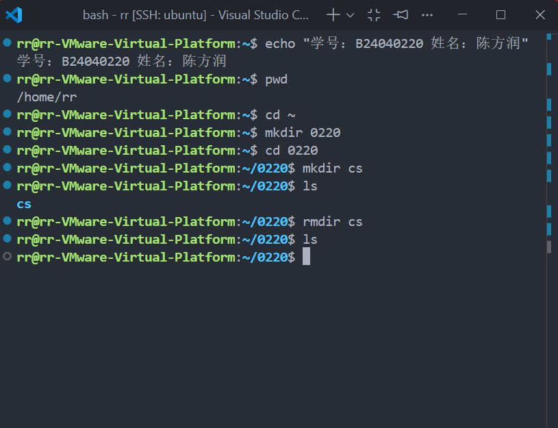
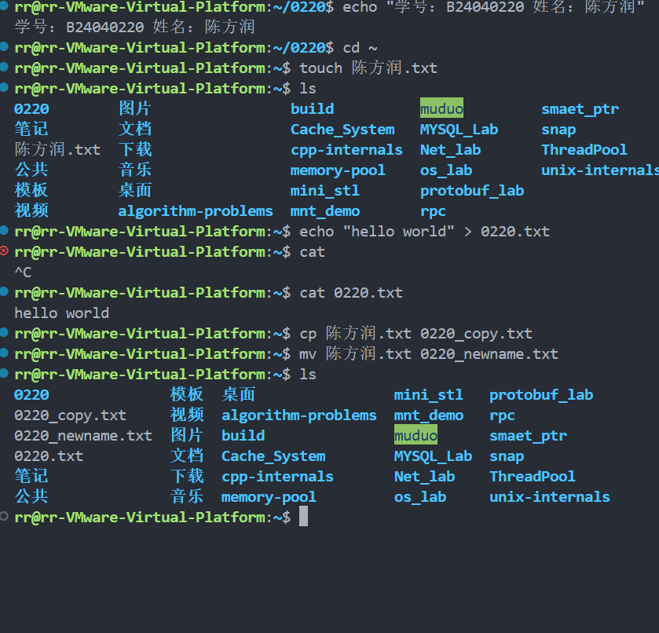
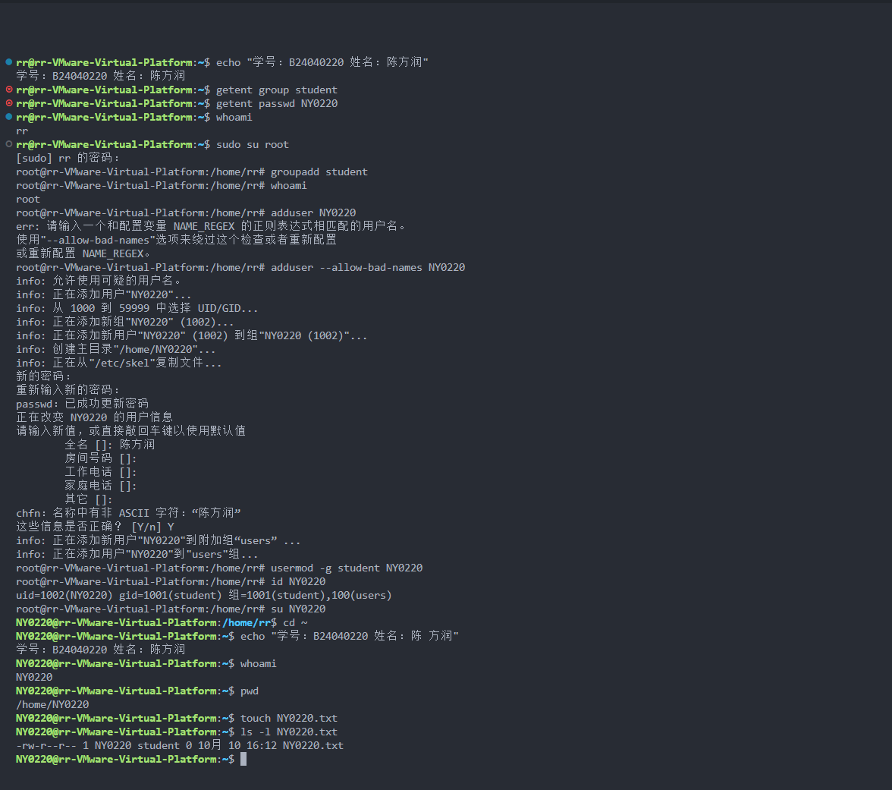
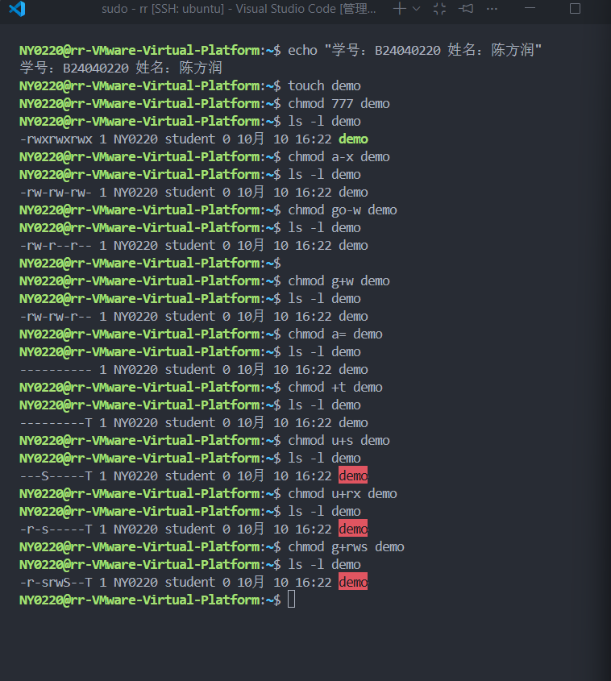
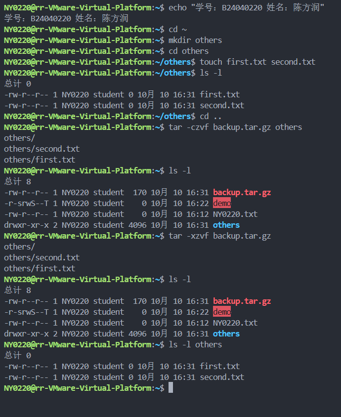
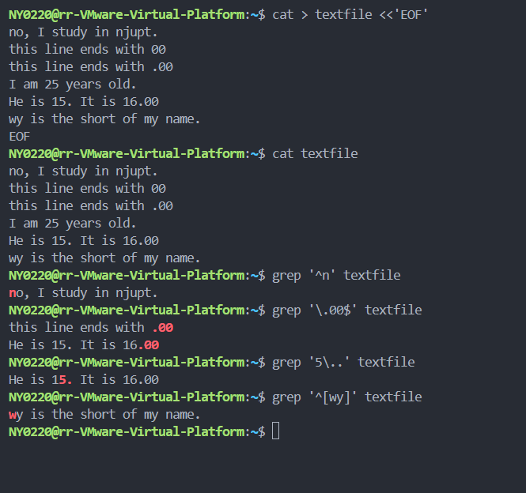

# 实验1：Linux 基本命令与操作

学号：B24040220；姓名：陈方润。

环境：VMware Ubuntu，使用 VS Code Remote SSH 连接。

## 一、目录操作

在原有用户 `rr` 下执行：

```bash
echo "学号：B24040220 姓名：陈方润" # 显示身份信息，便于截图核对
pwd # 查看当前工作目录
cd ~ # 返回当前用户的主目录
mkdir 0220 # 创建以学号后四位命名的目录
cd 0220 # 进入该目录
mkdir cs # 创建子目录 cs
ls # 检查子目录是否创建成功
rmdir cs # 删除空目录 cs
ls # 检查删除结果
```

结果：在 `/home/rr/0220` 中成功创建并删除空目录 `cs`。



## 二、文件操作

在用户 `rr` 的主目录下执行：

```bash
cd ~ # 返回 /home/rr
touch 陈方润.txt # 创建姓名命名的空文件
ls # 查看目录中的文件
echo "hello world" > 0220.txt # 将文本写入学号后四位命名的文件
cat 0220.txt # 查看文件内容
cp 陈方润.txt 0220_copy.txt # 复制姓名文件
mv 陈方润.txt 0220_newname.txt # 将姓名文件重命名
ls # 检查复制和重命名结果
```

结果：`0220.txt` 内容为 `hello world`，文件复制和重命名成功。



## 三、用户与用户组管理

```bash
sudo su root # 切换到 root，输入 rr 用户的 sudo 密码
groupadd student # 创建 student 用户组
adduser --allow-bad-names NY0220 # 允许该用户名并交互式创建用户
usermod -g student NY0220 # 将用户的主组设置为 student
id NY0220 # 检查用户 ID、主组和附加组
su NY0220 # 从 root 切换到实验用户
cd ~ # 进入实验用户的主目录
whoami # 验证当前用户名
pwd # 验证当前工作目录
touch NY0220.txt # 创建实验用户命名的空文件
ls -l NY0220.txt # 检查文件所有者、所属组及权限
```

结果：用户为 `NY0220`，主目录为 `/home/NY0220`；新文件所有者为 `NY0220`，所属组为 `student`。

说明：大写用户名被默认检查拒绝，使用 `--allow-bad-names` 后创建成功。



## 四、文件权限管理

在用户 `NY0220` 下创建 `demo`，依次修改权限，每次修改后使用 `ls -l demo` 验证：

```bash
touch demo # 创建用于权限实验的普通文件
chmod 777 demo # 为所有者、所属组和其他用户设置读写执行权限
ls -l demo # 验证当前权限
chmod a-x demo # 删除所有用户的执行权限
ls -l demo # 验证当前权限
chmod go-w demo # 删除所属组和其他用户的写权限
ls -l demo # 验证当前权限
chmod g+w demo # 恢复所属组的写权限
ls -l demo # 验证当前权限
chmod a= demo # 清除所有用户的普通权限
ls -l demo # 验证当前权限
chmod +t demo # 设置 sticky 位
ls -l demo # 验证当前权限
chmod u+s demo # 设置 SUID 位
ls -l demo # 验证当前权限
chmod u+rx demo # 为所有者增加读和执行权限
ls -l demo # 验证当前权限
chmod g+rws demo # 为所属组增加读、写权限和 SGID 位，不增加执行权限
ls -l demo # 验证最终权限
```

实际结果如下，各步骤以此前的权限为基础继续修改：

| 命令 | `ls -l` 显示的权限 |
| --- | --- |
| `chmod 777 demo` | `-rwxrwxrwx` |
| `chmod a-x demo` | `-rw-rw-rw-` |
| `chmod go-w demo` | `-rw-r--r--` |
| `chmod g+w demo` | `-rw-rw-r--` |
| `chmod a= demo` | `----------` |
| `chmod +t demo` | `---------T` |
| `chmod u+s demo` | `---S-----T` |
| `chmod u+rx demo` | `-r-s-----T` |
| `chmod g+rws demo` | `-r-srwS--T` |

结果：权限变化与上表一致。`g+rws` 不增加执行权限，因此最终所属组权限显示为 `rwS`。



## 五、归档压缩

在用户 `NY0220` 下执行：

```bash
cd ~ # 返回 /home/NY0220
mkdir others # 创建待归档目录
cd others # 进入该目录
touch first.txt second.txt # 创建两个空文件
ls -l # 检查文件信息
cd .. # 返回父目录，使 others 成为可访问的相对路径
tar -czvf backup.tar.gz others # 将 others 归档并使用 gzip 压缩
ls -l # 检查生成的归档文件
tar -xzvf backup.tar.gz # 在当前目录解压归档
ls -l # 检查解压后的目录内容
ls -l others # 检查目录中的两个文件
```

结果：成功生成并解压 `backup.tar.gz`，`others` 中两个空文件均存在。归档在父目录执行，本次解压未先删除原文件。



## 六、文本搜索

准备 `textfile` 后执行：

```bash
cat textfile # 查看准备好的文本内容
grep '^n' textfile # 搜索以 n 开头的行
grep '\.00$' textfile # 搜索以字面量 .00 结尾的行
grep '5\..' textfile # 搜索包含数字 5、字面量句点和其后任意一个字符的行
grep '^[wy]' textfile # 搜索以 w 或 y 开头的行
```

实际匹配结果：

| 搜索模式 | 匹配到的整行文本 |
| --- | --- |
| `^n` | `no, I study in njupt.` |
| `\.00$` | `this line ends with .00` 和 `He is 15. It is 16.00` |
| `5\..` | `He is 15. It is 16.00` |
| `^[wy]` | `wy is the short of my name.` |


